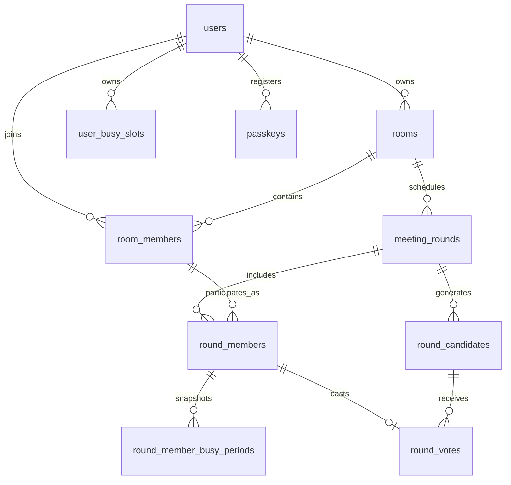

# Waongpa Data Dictionary

เอกสารนี้อธิบาย schema ที่ได้จาก migrations ใน checkout `main` ปัจจุบันของโครงการ ณ 13 ตุลาคม 2026 ใช้ร่วมกับไฟล์ DDL สำหรับ MySQL Workbench ที่ `database/diagrams/waongpa-mysql-workbench.sql`

> ขอบเขตสำคัญ: schema ใน branch `main` ปัจจุบันยังไม่มี `busy_slot_recurrence_rules` หรือ `user_busy_slots.recurrence_rule_id` ซึ่งเป็นงาน recurring ที่เคยทำใน branch `feature/recurring-user-busy-slots` หากจะสร้าง ERD ของ branch นั้น ให้ใช้ migrations ของ branch นั้นแทนและปรับเอกสารนี้ก่อนนำไปอ้างอิง
>
> ตรวจ `php artisan migrate:status` แล้วพบว่า migration `2026_10_10_000001_create_round_voting_tables` ยัง Pending ในฐานข้อมูล SQLite ที่ตั้งค่าไว้ แต่ไฟล์ data dictionary/DDL นี้รวมตาราง `round_candidates`, `round_votes` และ `candidates_generated_at` ตาม migration ใน source code เพื่อแสดง schema เป้าหมายครบทั้งโปรเจกต์ หลัง migrate จริงจึงจะมีตารางเหล่านี้ใน local database

## 1. ภาพรวม ER Model

ความสัมพันธ์หลักของ scheduling คือ `rooms → meeting_rounds → round_members`; สมาชิกห้องเชื่อมกับแต่ละรอบผ่าน `room_members → round_members`. ช่วงเวลาส่วนตัวของผู้ใช้ใน `user_busy_slots` ถูกอ่านเพื่อสร้าง snapshot แต่ไม่มี FK จาก snapshot กลับไปยังกิจกรรมต้นทาง เพื่อไม่เก็บชื่อกิจกรรมและไม่ผูกอายุข้อมูล snapshot กับกิจกรรมส่วนตัว

สัญลักษณ์: PK = Primary Key, FK = Foreign Key, UQ = Unique, IDX = Index. ชนิดด้านล่างอธิบายชนิดตาม Laravel migrations และ mapping ที่ใช้ใน MySQL 8.0 DDL

## 2. ตารางข้อมูลระบบนัดหมาย

### 2.1 `rooms` — ห้อง

| Column | ชนิด / Null | Default | Key | ความหมาย |
|---|---|---|---|---|
| `id` | BIGINT UNSIGNED, not null | auto increment | PK | รหัสห้อง |
| `owner_id` | BIGINT UNSIGNED, not null | — | FK → `users.id` | ผู้ใช้เจ้าของห้อง; ลบ user ที่เป็นเจ้าของไม่ได้ (`RESTRICT`) |
| `name` | VARCHAR(150), not null | — | — | ชื่อห้อง |
| `description` | TEXT, nullable | NULL | — | คำอธิบายห้อง |
| `visibility` | VARCHAR(10), not null | `private` | — | การมองเห็น; ค่าที่แอปใช้โดยหลักคือ `public` / `private` |
| `join_code` | VARCHAR(12), not null | — | UQ | รหัสใช้เข้าห้อง |
| `created_at` | TIMESTAMP, nullable | NULL | — | เวลาสร้าง |
| `updated_at` | TIMESTAMP, nullable | NULL | — | เวลาแก้ไข |
| `deleted_at` | TIMESTAMP, nullable | NULL | — | soft delete ห้อง; model `Room` ใช้ `SoftDeletes` |

**ความสัมพันธ์:** ห้องมีเจ้าของหนึ่งคน, สมาชิกหลายคน, และรอบหลายรอบ. การลบแบบปกติเป็น soft delete ไม่ได้ลบข้อมูลลูกอัตโนมัติ

### 2.2 `room_members` — สมาชิกห้อง

| Column | ชนิด / Null | Default | Key | ความหมาย |
|---|---|---|---|---|
| `id` | BIGINT UNSIGNED, not null | auto increment | PK | รหัสแถวสมาชิกห้อง |
| `room_id` | BIGINT UNSIGNED, not null | — | FK → `rooms.id` | ห้องที่เป็นสมาชิก; FK delete เป็น `RESTRICT` |
| `user_id` | BIGINT UNSIGNED, not null | — | FK → `users.id` | ผู้ใช้; FK delete เป็น `RESTRICT` |
| `role` | VARCHAR(15), not null | `student` | — | บทบาท เช่น `student` หรือ `professor`; แอปใช้ประกอบกติกา professor |
| `weight` | DECIMAL(6,2), not null | `1.00` | — | น้ำหนักสมาชิกตาม domain; candidate readiness ในโค้ดปัจจุบันนับคนว่าง ไม่ได้คูณ weight |
| `status` | VARCHAR(10), not null | `active` | — | สถานะสมาชิกห้อง เช่น active/left ตาม controller |
| `joined_at` | DATETIME, not null | — | — | เวลาที่เข้าห้อง |
| `left_at` | DATETIME, nullable | NULL | — | เวลาที่ออกห้อง |
| `created_at` | TIMESTAMP, nullable | NULL | — | เวลาสร้าง |
| `updated_at` | TIMESTAMP, nullable | NULL | — | เวลาแก้ไข |

**Constraints:** UQ (`room_id`, `user_id`) — ผู้ใช้มีแถวสมาชิกต่อห้องได้หนึ่งแถว; การออก/กลับเข้าห้องใช้แถวเดิมและ status ตาม logic ปัจจุบัน

### 2.3 `meeting_rounds` — รอบนัดหมาย

| Column | ชนิด / Null | Default | Key | ความหมาย |
|---|---|---|---|---|
| `id` | BIGINT UNSIGNED, not null | auto increment | PK | รหัสรอบ |
| `room_id` | BIGINT UNSIGNED, not null | — | FK → `rooms.id` | ห้องต้นสังกัด; delete เป็น `RESTRICT` |
| `round_no` | INT UNSIGNED, not null | — | UQ ร่วม | ลำดับรอบภายในห้อง |
| `status` | VARCHAR(15), not null | `active` | — | สถานะรอบ เช่น active/completed/cancelled |
| `phase` | VARCHAR(10), not null | `join` | — | เฟส `join`, `review`, `voting`, `final` |
| `active_marker` | TINYINT UNSIGNED, nullable | `1` | UQ ร่วม | marker ให้มี active round ได้หนึ่งรอบต่อห้อง; รอบที่ไม่ active ตั้ง NULL; unique index ยอมให้มี NULL หลายแถวใน MySQL |
| `search_start_date` | DATE, not null | — | — | วันแรกที่ค้นหาเวลา |
| `search_end_date` | DATE, not null | — | — | วันสุดท้ายที่ค้นหาเวลา |
| `daily_start_time` | TIME, not null | `08:00:00` | — | เวลาเริ่มกรอบรายวัน |
| `daily_end_time` | TIME, not null | `18:00:00` | — | เวลาจบกรอบรายวัน |
| `duration_minutes` | SMALLINT UNSIGNED, not null | `60` | — | ระยะเวลานัด; validation บังคับตามกติกาแอป (เช่น พหุคูณ 30) |
| `professor_rule` | ENUM(`at_least`, `all`), not null | `at_least` | — | เงื่อนไขจำนวนอาจารย์ที่ต้องว่าง |
| `min_professors` | SMALLINT UNSIGNED, nullable | `1` | — | จำนวนขั้นต่ำเมื่อใช้ `at_least`; เมื่อเลือก `all` controller ตั้ง NULL |
| `join_starts_at` | DATETIME, not null | — | — | เวลาแผนเริ่ม Join |
| `review_starts_at` | DATETIME, not null | — | — | เวลาปิด Join/เริ่ม Review และจุดอ้างอิง delay snapshot |
| `voting_starts_at` | DATETIME, not null | — | — | เวลาเปิด vote ตามแผน |
| `final_starts_at` | DATETIME, not null | — | — | deadline vote และเวลาเริ่ม final |
| `cancelled_at` | DATETIME, nullable | NULL | — | เวลา cancel |
| `snapshot_taken_at` | TIMESTAMP, nullable | NULL | — | เวลาที่คัดลอก busy periods ของสมาชิกครบทั้งรอบ; NULL หมายถึงยังไม่มี snapshot |
| `candidates_generated_at` | DATETIME, nullable | NULL | — | เวลาที่คำนวณ candidates แล้ว; ป้องกันสร้างซ้ำ |
| `created_at` | TIMESTAMP, nullable | NULL | — | เวลาสร้าง |
| `updated_at` | TIMESTAMP, nullable | NULL | — | เวลาแก้ไข |

**Constraints:** UQ (`room_id`, `round_no`) และ UQ (`room_id`, `active_marker`). FK room delete เป็น `RESTRICT`.

**หมายเหตุ:** migrations รุ่นแรกสร้าง `round_members.confirmed_at` แต่ migration `2026_10_02_000002_add_round_snapshots` backfill ไป `meeting_rounds.snapshot_taken_at` แล้ว drop `confirmed_at`; ดังนั้น `confirmed_at` ไม่อยู่ใน final schema ปัจจุบัน

### 2.4 `round_members` — ผู้เข้าร่วมรอบ

| Column | ชนิด / Null | Default | Key | ความหมาย |
|---|---|---|---|---|
| `id` | BIGINT UNSIGNED, not null | auto increment | PK | รหัสการเข้ารอบ |
| `meeting_round_id` | BIGINT UNSIGNED, not null | — | FK → `meeting_rounds.id` | รอบ; delete เป็น `RESTRICT` |
| `room_member_id` | BIGINT UNSIGNED, not null | — | FK → `room_members.id` | สมาชิกห้องที่เข้ารอบ; delete เป็น `RESTRICT` |
| `role` | VARCHAR(15), not null | — | — | snapshot role ในบริบทของรอบ |
| `weight` | DECIMAL(6,2), not null | — | — | snapshot weight ในบริบทของรอบ |
| `joined_at` | DATETIME, not null | — | — | เวลาเข้ารอบ |
| `created_at` | TIMESTAMP, nullable | NULL | — | เวลาสร้าง |
| `updated_at` | TIMESTAMP, nullable | NULL | — | เวลาแก้ไข |

**Constraints:** UQ (`meeting_round_id`, `room_member_id`) — สมาชิกหนึ่งคนมีการเข้าร่วมต่อรอบได้หนึ่งแถว

### 2.5 `user_busy_slots` — กิจกรรม/เวลาที่ผู้ใช้ไม่ว่าง

| Column | ชนิด / Null | Default | Key | ความหมาย |
|---|---|---|---|---|
| `id` | BIGINT UNSIGNED, not null | auto increment | PK | รหัสกิจกรรมส่วนตัว |
| `user_id` | BIGINT UNSIGNED, not null | — | FK → `users.id` | เจ้าของ; ลบ user แล้วกิจกรรม hard-delete cascade |
| `name` | VARCHAR(150), not null | — | — | ชื่อกิจกรรมส่วนตัว; ห้ามคัดลอกลง snapshot หรือแสดงต่อสมาชิกอื่น |
| `start_at` | DATETIME, not null | — | IDX ร่วม | เวลาเริ่ม |
| `end_at` | DATETIME, not null | — | — | เวลาจบ; controller validate ให้หลัง start |
| `created_at` | TIMESTAMP, nullable | NULL | — | เวลาสร้าง |
| `updated_at` | TIMESTAMP, nullable | NULL | — | เวลาแก้ไข |
| `deleted_at` | TIMESTAMP, nullable | NULL | — | soft delete; query ปกติไม่ควรนำแถวนี้ไปใช้ |

**Index:** (`user_id`, `start_at`). กิจกรรมผูกเจ้าของโดยตรง; schema ปัจจุบันของ branch `main` ไม่มี recurrence fields

### 2.6 `round_member_busy_periods` — snapshot ช่วงไม่ว่างของผู้เข้ารอบ

| Column | ชนิด / Null | Default | Key | ความหมาย |
|---|---|---|---|---|
| `id` | BIGINT UNSIGNED, not null | auto increment | PK | รหัส snapshot period |
| `round_member_id` | BIGINT UNSIGNED, not null | — | FK, IDX → `round_members.id` | เจ้าของ snapshot; ลบ round member แล้ว periods cascade |
| `start_at` | DATETIME, not null | — | — | เวลาเริ่มช่วงไม่ว่าง (ถูก clip เข้า daily window แล้ว) |
| `end_at` | DATETIME, not null | — | — | เวลาจบช่วงไม่ว่าง |

ตารางนี้ไม่มี timestamps, soft delete, ชื่อกิจกรรม หรือ version history. `snapshot_taken_at` ที่รอบบอก snapshot ทั้งชุดเสร็จเมื่อใด

### 2.7 `round_candidates` — ตัวเลือกเวลานัด

| Column | ชนิด / Null | Default | Key | ความหมาย |
|---|---|---|---|---|
| `id` | BIGINT UNSIGNED, not null | auto increment | PK | รหัส candidate |
| `meeting_round_id` | BIGINT UNSIGNED, not null | — | FK → `meeting_rounds.id` | รอบ; delete รอบ cascade |
| `start_at` | DATETIME, not null | — | UQ ร่วม | เวลาเริ่มตัวเลือก |
| `end_at` | DATETIME, not null | — | — | เวลาจบตัวเลือก |
| `available_count` | INT UNSIGNED, not null | — | — | จำนวนสมาชิกที่ว่างทั้งช่วง |
| `professor_count` | INT UNSIGNED, not null | — | — | จำนวนอาจารย์ที่ว่าง |
| `available_member_ids` | JSON, not null | — | — | array ของ `round_members.id` ที่ว่าง; ไม่มี FK รายสมาชิกเพราะเก็บเป็น JSON |
| `is_winner` | BOOLEAN, not null | false | — | candidate ที่ได้เลือกเป็นผลสุดท้าย |

**Constraints:** UQ (`meeting_round_id`, `start_at`). ไม่มี timestamps ตาม migration ปัจจุบัน

### 2.8 `round_votes` — คะแนนโหวต

| Column | ชนิด / Null | Default | Key | ความหมาย |
|---|---|---|---|---|
| `id` | BIGINT UNSIGNED, not null | auto increment | PK | รหัส vote |
| `round_member_id` | BIGINT UNSIGNED, not null | — | UQ + FK → `round_members.id` | ผู้โหวต; cascade เมื่อลบ round member; unique บังคับหนึ่ง vote ต่อคน/รอบ |
| `round_candidate_id` | BIGINT UNSIGNED, not null | — | FK → `round_candidates.id` | candidate ที่เลือก; cascade เมื่อลบ candidate |
| `created_at` | TIMESTAMP, nullable | NULL | — | เวลาสร้าง vote |
| `updated_at` | TIMESTAMP, nullable | NULL | — | เวลาเปลี่ยน vote ล่าสุด |

Schema ไม่ได้บังคับว่า round member และ candidate ต้องอยู่ meeting round เดียวกัน เพราะไม่มี `meeting_round_id` ใน vote; controller ต้องตรวจ candidate ผ่าน relationship ของรอบที่ route ระบุ

## 3. ตาราง Authentication และ Infrastructure

ตารางด้านล่างมาจาก migrations ของ Laravel/Fortify และใช้เพื่อ login, session, cache, queue หรือ migration bookkeeping; โดยปกติไม่ใช่แกน ER ของระบบนัดหมาย แต่รวมไว้ใน SQL เพื่อให้ DDL สอดคล้องกับ schema ทั้งแอป

### 3.1 `passkeys`

| Column | ชนิด / Null | Key | ความหมาย |
|---|---|---|---|
| `id` | BIGINT UNSIGNED, not null, auto increment | PK | รหัส passkey |
| `user_id` | BIGINT UNSIGNED, not null | FK → users (CASCADE), IDX | ผู้ใช้เจ้าของ passkey |
| `name` | VARCHAR(255), not null | — | ชื่อที่ผู้ใช้ตั้งให้ credential |
| `credential_id` | VARCHAR(255), not null | UQ | credential identifier |
| `credential` | JSON, not null | — | credential payload |
| `last_used_at` | TIMESTAMP, nullable | — | ใช้ล่าสุดเมื่อใด |
| `created_at`, `updated_at` | TIMESTAMP, nullable | — | timestamps |

### 3.2 `password_reset_tokens`

| Column | ชนิด / Null | Key | ความหมาย |
|---|---|---|---|
| `email` | VARCHAR(255), not null | PK | email สำหรับกู้รหัสผ่าน |
| `token` | VARCHAR(255), not null | — | reset token (ควรถือเป็นข้อมูลลับ) |
| `created_at` | TIMESTAMP, nullable | — | เวลาสร้าง token |

ไม่มี FK ไป `users`; เป็นตารางของ Laravel password broker

### 3.3 `sessions`

| Column | ชนิด / Null | Key | ความหมาย |
|---|---|---|---|
| `id` | VARCHAR(255), not null | PK | session id |
| `user_id` | BIGINT UNSIGNED, nullable | IDX | user ที่ login; migration ไม่มี FK |
| `ip_address` | VARCHAR(45), nullable | — | IP address |
| `user_agent` | TEXT, nullable | — | browser agent |
| `payload` | LONGTEXT, not null | — | session payload |
| `last_activity` | INT, not null | IDX | เวลา activity ตาม Unix timestamp |

### 3.4 `cache` และ `cache_locks`

`cache`: `key` VARCHAR(255) PK, `value` MEDIUMTEXT, `expiration` BIGINT IDX. เก็บ cache entries.

`cache_locks`: `key` VARCHAR(255) PK, `owner` VARCHAR(255), `expiration` BIGINT IDX. เก็บ cache lock owner และเวลาหมดอายุ

### 3.5 Queue tables

`jobs`: `id` BIGINT UNSIGNED PK, `queue` VARCHAR(255) IDX, `payload` LONGTEXT, `attempts` SMALLINT UNSIGNED, `reserved_at` INT UNSIGNED NULL, `available_at` INT UNSIGNED, `created_at` INT UNSIGNED.

`job_batches`: `id` VARCHAR(255) PK, `name` VARCHAR(255), `total_jobs` INT, `pending_jobs` INT, `failed_jobs` INT, `failed_job_ids` LONGTEXT, `options` MEDIUMTEXT NULL, `cancelled_at` INT NULL, `created_at` INT, `finished_at` INT NULL.

`failed_jobs`: `id` BIGINT UNSIGNED PK, `uuid` VARCHAR(255) UQ, `connection` VARCHAR(255), `queue` VARCHAR(255), `payload` LONGTEXT, `exception` LONGTEXT, `failed_at` TIMESTAMP default current timestamp; index (`connection`, `queue`, `failed_at`).

### 3.6 `migrations`

Laravel migration repository สร้างตารางนี้เมื่อ migrate: `id` INT UNSIGNED PK auto increment, `migration` VARCHAR(255), `batch` INT. ไม่ได้ประกาศเป็น migration ไฟล์ของแอป แต่ script ERD รวมไว้เป็นตาราง infrastructure ที่ Laravel สร้างจริง

## 4. Referential actions และ cardinality

| Parent | Child | Cardinality | FK action |
|---|---|---|---|
| `users` | `rooms` ผ่าน `owner_id` | user 1 → rooms 0..N | RESTRICT |
| `users` | `room_members` | user 1 → memberships 0..N | RESTRICT |
| `rooms` | `room_members` | room 1 → memberships 0..N | RESTRICT |
| `rooms` | `meeting_rounds` | room 1 → rounds 0..N | RESTRICT |
| `meeting_rounds` | `round_members` | round 1 → participants 0..N | RESTRICT |
| `room_members` | `round_members` | room membership 1 → round participations 0..N | RESTRICT |
| `round_members` | `round_member_busy_periods` | participant 1 → periods 0..N | CASCADE |
| `meeting_rounds` | `round_candidates` | round 1 → candidates 0..N | CASCADE |
| `round_members` | `round_votes` | participant 1 → vote 0..1 | CASCADE |
| `round_candidates` | `round_votes` | candidate 1 → votes 0..N | CASCADE |
| `users` | `user_busy_slots` | user 1 → activities 0..N | CASCADE (hard delete) |
| `users` | `passkeys` | user 1 → passkeys 0..N | CASCADE |

`rooms.deleted_at` เป็น soft delete จึงไม่ได้ trigger FK action. `round_member_busy_periods` migration เพิ่ม index บน FK แยก; MySQL อาจสร้าง supporting index ให้อยู่แล้วแต่ SQL รักษา index ที่ระบุใน migration ไว้

## 5. Business rules ที่ schema ไม่ได้บังคับครบ

ข้อจำกัดต่อไปนี้อยู่ใน Laravel validation/controller/job ไม่ได้บังคับด้วย CHECK/FK ทุกข้อ:

- `rooms.visibility` จำกัดค่าด้วย application logic; schema เป็น varchar
- `room_members.status` และ `role` ใช้ค่า enum ทางธุรกิจแต่ schema เป็น varchar
- `meeting_rounds.status`/`phase` เป็น varchar; transition ที่ถูกต้องต้องตรวจใน `ProcessMeetingRound`/controllers
- `join_starts_at < review_starts_at < voting_starts_at < final_starts_at`
- เวลาเฟสถัดไปต้องอยู่อนาคตใน create/reset validation
- `search_start_date <= search_end_date`; daily start < daily end
- `duration_minutes` เป็นจำนวนบวกและพหุคูณ 30; ต้องไม่เกินกรอบรายวัน
- `min_professors` ต้องสัมพันธ์กับ `professor_rule`; เมื่อใช้ `all` controller ตั้ง NULL
- `room_members.weight` และ `round_members.weight` ต้องผ่านช่วงที่ระบบกำหนด; DDL ไม่กำหนดช่วงขั้นต่ำ/สูงสุด
- `round_member_busy_periods.start_at < end_at`
- `round_candidates.start_at < end_at`, candidate ต้องอยู่ใน daily window, slot 30-minute grid, professor requirement ผ่าน
- สมาชิกโหวตได้เฉพาะ candidate ในรอบเดียวกันและเมื่อ candidate มี `round_member_id` อยู่ใน `available_member_ids`
- มี active round เดียวต่อห้องโดย unique `active_marker`, โดยแอปต้องเปลี่ยน marker เป็น NULL เมื่อจบรอบ/cancel
- `available_member_ids` JSON คือ application-level references; DB ไม่ตรวจว่า IDs เป็นสมาชิกในรอบเดียวกัน

## 6. ความสัมพันธ์กับ lifecycle ของรอบ

1. เจ้าของสร้าง `rooms` row.
2. ผู้ใช้เข้าห้องและสร้าง/ใช้ `room_members` row.
3. เจ้าของสร้าง `meeting_rounds` row และเลือกผู้เข้าร่วมเป็น `round_members`.
4. ถึง `review_starts_at` ระบบปิด Join และรอ delay ที่ตั้งใน `config/rounds.php`.
5. Snapshot job คัดลอกเฉพาะ start/end ของ UserBusySlot ที่ทับช่วงค้นหาและกรอบเวลารายวันเข้า `round_member_busy_periods`; ตั้ง `snapshot_taken_at` ใน transaction เดียวกัน.
6. สร้าง `round_candidates` จาก snapshot โดยคิดทุก 30 นาที, duration, professor rule, available count และ available member IDs; ตั้ง `candidates_generated_at`.
7. ช่วง Voting สมาชิกในรอบสร้าง/เปลี่ยน `round_votes` ได้หนึ่งรายการต่อคน.
8. ถึง final ระบบเลือก candidate จากคะแนน; ถ้าไม่มีใครโหวตให้ใช้ candidate อันดับแรก (availability สูงสุด, เวลาเร็วสุด); ถ้าไม่มี candidate เลยจบรอบแบบไม่มี winner.
9. Reset รอบ active ลบ snapshot/candidates (votes cascade), เก็บ round members ไว้ และกลับไป Join ตาม logic ของ controller ปัจจุบัน.

## 7. MySQL Workbench

DDL สำหรับ ERD อยู่ใน `database/diagrams/waongpa-mysql-workbench.sql` สร้างตารางตาม migrations ปัจจุบันโดยไม่สร้าง database และไม่ลบข้อมูลที่มีอยู่

นำเข้าแบบ reverse engineer:

1. เปิด MySQL Workbench.
2. เลือก **File → Import → Reverse Engineer MySQL Create Script**.
3. เลือก `database/diagrams/waongpa-mysql-workbench.sql`.
4. ตรวจ encoding เป็น UTF-8 และเลือก schema/model ที่ต้องการ.
5. กด execute/next ตาม wizard แล้วจัดวาง EER diagram.

หรือหากมีฐานข้อมูล MySQL ที่สร้างจาก migrations แล้ว ใช้ **Database → Reverse Engineer** เพื่ออ่าน schema จริงจาก server แทน script

ไฟล์ SQL ตั้งใจให้เป็น DDL สำหรับ MySQL 8.0/InnoDB เพื่อสร้าง EER model; ไม่ได้รวมข้อมูลจริง, password hashes, session payloads หรือ seed data

## 8. สิ่งที่ต้องตรวจเมื่อ schema เปลี่ยน

- ตรวจ migrations ตามลำดับทั้งหมด อย่าใช้เฉพาะ migration แรกของตาราง เพราะ migration ถัดไปอาจเพิ่มหรือลบ column (ตัวอย่าง `confirmed_at` ถูก drop)
- ตรวจ migration rollback behavior โดยเฉพาะ FK/unique index และ backfill ที่ย้อนข้อมูลไม่ได้
- แก้ทั้ง data dictionary และ Workbench DDL ให้ตรง final schema
- หากต้องการเพิ่ม recurring บน branch `main`, เพิ่ม migration จริงก่อน แล้วปรับ ERD ให้มี `busy_slot_recurrence_rules` และ nullable unique `user_busy_slots.recurrence_rule_id`; อย่าคัดลอก schema จากอีก branch โดยไม่ cherry-pick/merge migrations
- หากเพิ่ม table ที่อ้างถึง candidate/vote/round member ให้กำหนด cascade/restrict ให้สอดคล้องกับ reset และ hard delete behavior
